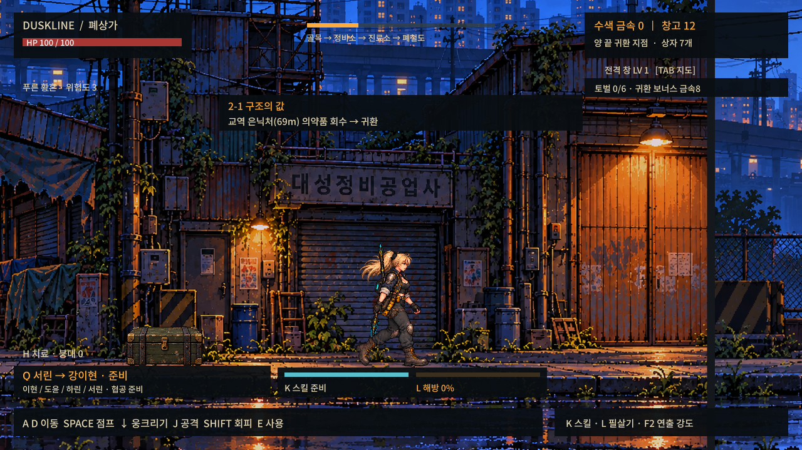
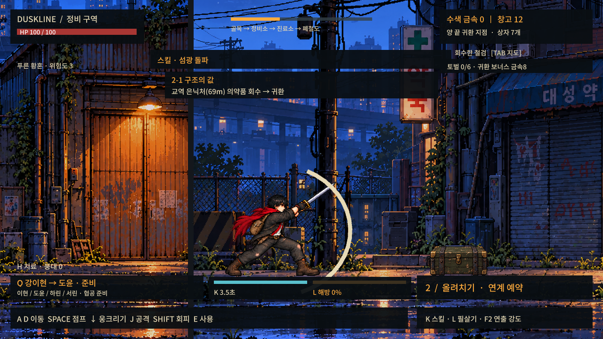
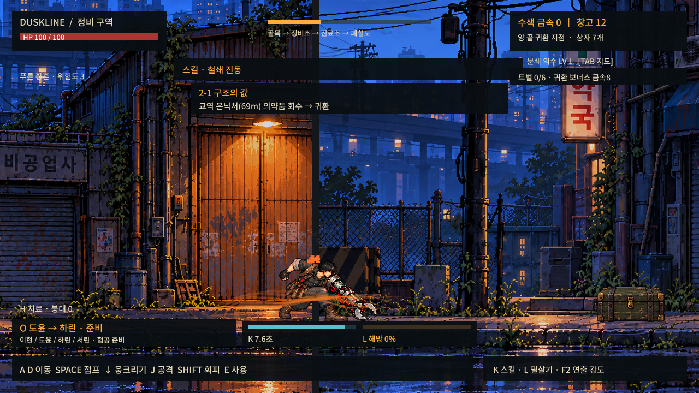
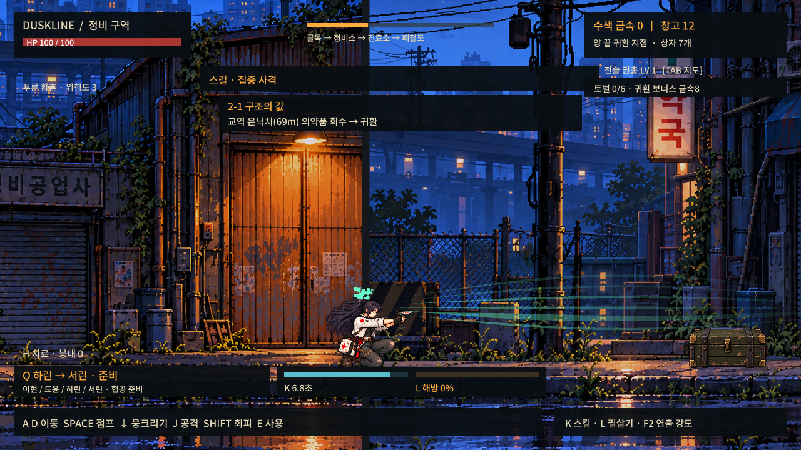
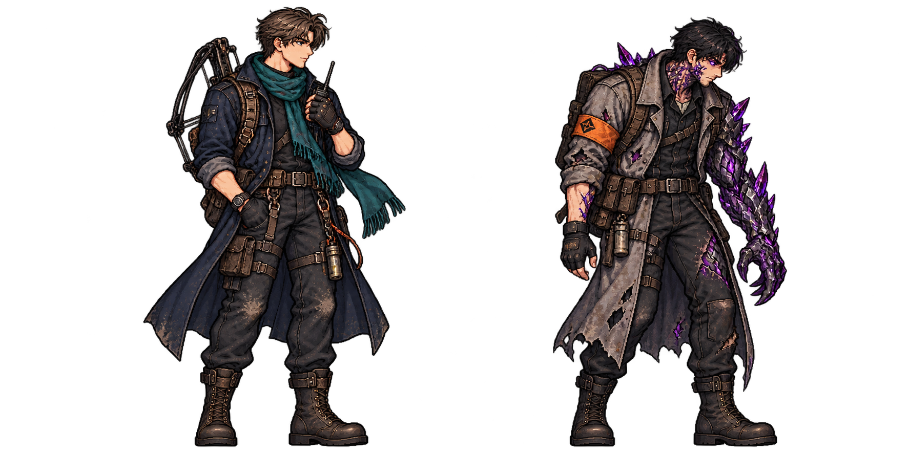
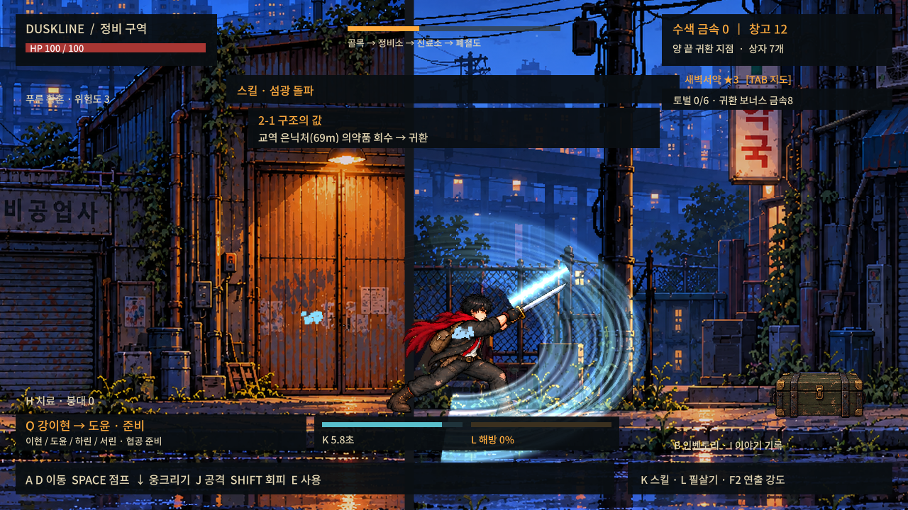
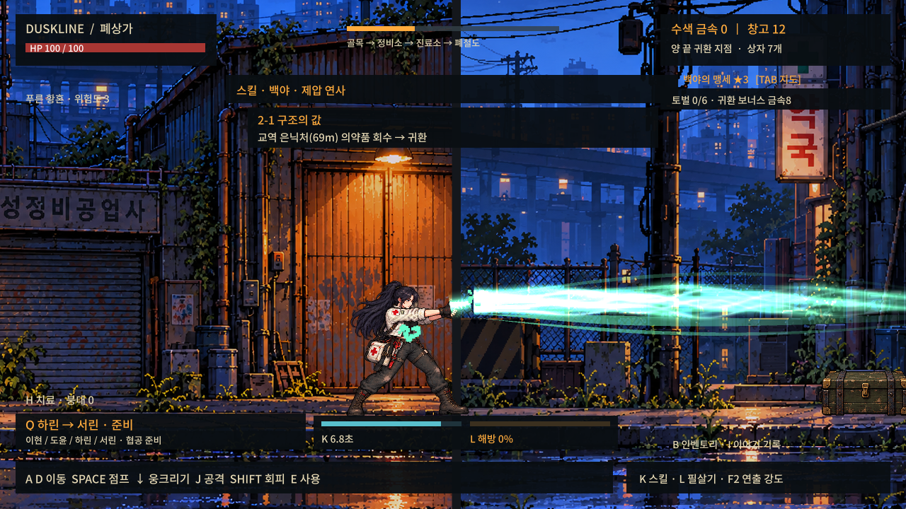

# 황혼선 — Duskline

**Unity 6.2 기반 2D 횡스크롤 태그 액션 생존 RPG**입니다. 해온시에서 좀비를 피해 물자를 회수하고 동료와 교대하며 싸워, 제7대피소를 유지하는 싱글플레이 시제품입니다.

## 플레이 화면

v0.11 Windows 실행 빌드에서 캡처한 1280×720 화면입니다. 모션 검증 모드에서 적을 비운 상태로 보행·공격·스킬을 촬영했습니다.

**서린 · 폐상가 보행**



**이현 · 올려치기**



**도윤 · 철쇄 진동**



**하린 · 집중 사격**



## 현재 개발 버전

`Unity2D/`가 최신 프로젝트입니다. Unity Hub에서 이 폴더를 열고 `Assets/Scenes/Slice.unity`를 실행하세요. 에디터 버전은 **6000.2.0f1**입니다.

- 이현·도윤·하린·서린의 전투 태그, 공격 취소·교대 예약, 2인 협공.
- 캐릭터별 8프레임 보행과 준비·타격·반동·회복 스킬 연출. 걷기·공격 시트 배율 보정.
- 연결된 횡스크롤 수색 맵, 출정별 네 분위기, 돌진형·중장갑·산성 투척형·철도 집행자 보스.
- Tab 지도 출정·안전 귀환, 무기 LV6 강화와 보스 코어, 3층 쉘터 시설·생산·습격.
- 1~4장 임무: 재희의 표식·주황 우의·비축처 약탈 조사·피해 복구 출정. 5장 도입 대화.

지역 기록 7종을 은닉처에서 회수하고 안전 귀환하면 I 기록 메뉴에 보관합니다. 좌우 방향키로 기록을 넘길 수 있습니다.

## 고유 무기와 새로운 인물





4장 진입 후 쉘터 1층의 태오에게 E로 말을 걸면 이수형의 행방을 알 수 있습니다. 수색 지역 58m에서 주변 적을 정리하고 이수형과 대화한 뒤 안전 귀환하면 공명 설계도가 보관됩니다. 공용 무기 LV6부터 쉘터 TAB 지도에서 제작 대상을 선택해 고유 무기를 제작·각성할 수 있습니다.

| 인물 | 고유 무기 | 연출 |
|---|---|---|
| 이현 | 새벽서약 | 청백색 겹검격 |
| 도윤 | 용광로 심장 | 주황 충격파 |
| 하린 | 백야의 맹세 | 녹빛 다중 사격 궤적 |
| 서린 | 천뢰 쌍성 | 보랏빛 번개 |

제작/각성 비용은 금속 60·100·140, 보스 코어 2·3·4입니다. 각성은 3단계이며 캐릭터별로 보관됩니다. 각 단계마다 개인 무기 위력 +2, 스킬 사거리 +0.35가 적용됩니다. 공용 강화는 계속 모든 동료에게 적용됩니다. F2로 연출을 줄일 수 있습니다. 태오와 이수형은 대화 NPC이며 현재 조작 가능한 캐릭터는 아닙니다.



## 생존·쉘터 관리 (v0.13)

- 수색 귀환과 출정 시 체력을 자동 회복하지 않습니다. 저장 후 다시 실행해도 부상이 유지됩니다. 전투 불능 구조는 체력1입니다.
- 쉘터 1층 중앙의 침대: E로 식량1·물1을 쓰고 6초 휴식하여 체력45 회복. 자원이 없으면 8초 응급 휴식으로 체력30까지만 회복 가능합니다.
- 3층 재배: 종자1·물3으로 파종 → 물자를 가진 성공 귀환 2회 → 직접 수확(식량4·약초2·종자1). 실패/빈손 귀환에는 자라지 않습니다.
- **B 인벤토리**: 자원·재배, 치료품·아티팩트, 장비·전직의 세 탭. I는 이야기 기록입니다.
- 치료대 설치 후 약초2·물1로 약 제작, 약2·코어1로 소모형 회복 아티팩트 제작. 붕대25 / 약50 / 아티팩트는 전체 체력을 회복합니다.
- 고유 각성은 원본 무기를 유지하면서 발광·잔상·타격 효과를 강화합니다. 하린은 고유 무기 제작 후 B 장비 탭에서 연사 사수(6연발) / 관통 포격수(긴 준비, 강력한 장거리 단발)를 선택할 수 있습니다.

[이번 개발 명세](Docs/PRD/v0.13-Development-Spec.md) · [각성 연출 규칙](Docs/Art/v13-Weapon-Art.md)

## 조작

A/D·방향키 이동, 아래 웅크리기, Space 점프, J 공격, Shift 회피, K 스킬, L 필살기, Q 태그, E 상호작용, H 치료, Tab 지도, I 기록, B 인벤토리, F2 연출 감소.

## 빌드

PowerShell 예시(에디터 경로는 설치 위치에 맞게 수정):

```powershell
$env:DUSKLINE_BUILD_OUTPUT = 'D:/Builds/Duskline'
& 'D:/Unity/6000.2.0f1/Editor/Unity.exe' -batchmode -nographics -quit -projectPath "$PWD/Unity2D" -buildTarget Win64 -executeMethod SliceBuild.Build -logFile 'D:/Builds/duskline-build.log'
```

출력 경로를 지정하지 않으면 프로젝트의 상위 `Builds/Duskline`에 저장됩니다. 빌드 과정에서 모델 검사를 실행합니다. `--capture <출력접두사>` 인자로 실행하면 보행·스킬 자동 화면 검사 후 종료합니다. 검사용 실행은 사용자 저장을 수정하지 않습니다.

## 검증과 범위

v0.13: 모델 검사223개, Windows 빌드 오류0·경고0. 실제 실행에서 보행32/32 프레임과 스킬4종 확인. 결과는 [검증 기록](Docs/Validation-v0.13.md), 변경 내용은 [CHANGELOG](CHANGELOG.md)를 참고하세요.

성채 호송 본편, 자유 가구 배치, 모든 직업의 확장 트리는 아직 미구현입니다. 지도는 연결된 기존 지형이며 절차적 지형 생성이 아닙니다. 새 4장 임무는 기존 구역을 재사용합니다.

## 문서

- [PRD](Docs/PRD/Duskline-Shelter-PRD.md)
- [전체 이야기 초안](Docs/Story/Duskline-Storyline.md): 기획 범위이며 전체가 구현된 것은 아닙니다.
- [아트 제작 기록](Docs/Art/): 내장 image_gen 생성 및 참조·프롬프트 기록.
- 이전 Unreal·3D 프로젝트 파일을 제거하고 최신 Unity2D 프로젝트로 전환했습니다.

실행 파일·Unity 캐시·개인 저장 파일은 Git에 포함하지 않습니다. `DuskFont.ttf`는 Source 계열 폰트를 Duskline Sans로 이름 변경한 파일이며 원본 저작권 표기와 [SIL OFL](Unity2D/ThirdPartyNotices/SourceHanSans-OFL.txt)을 유지합니다.
